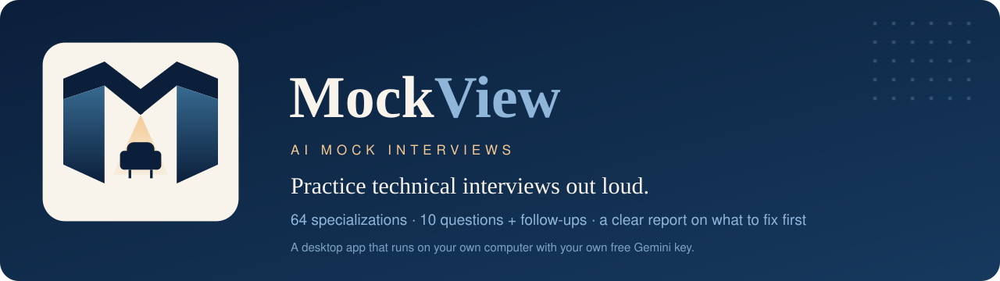
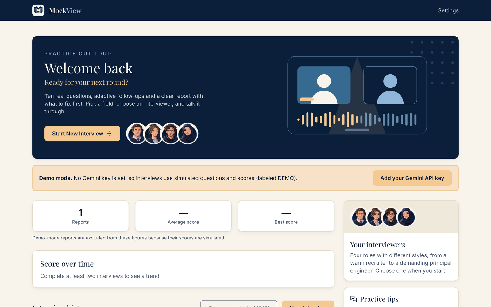
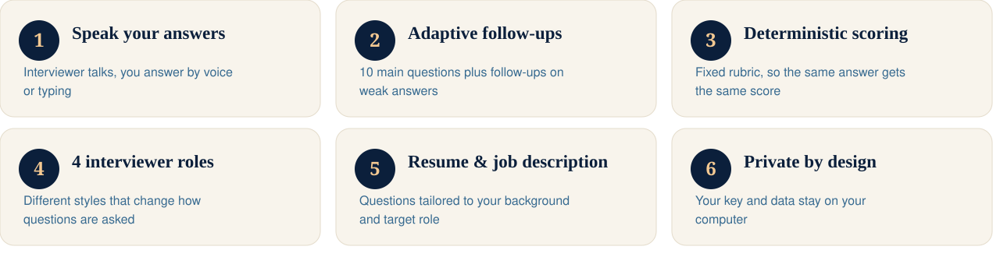
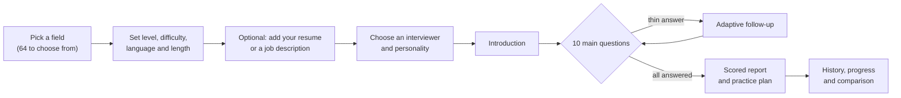
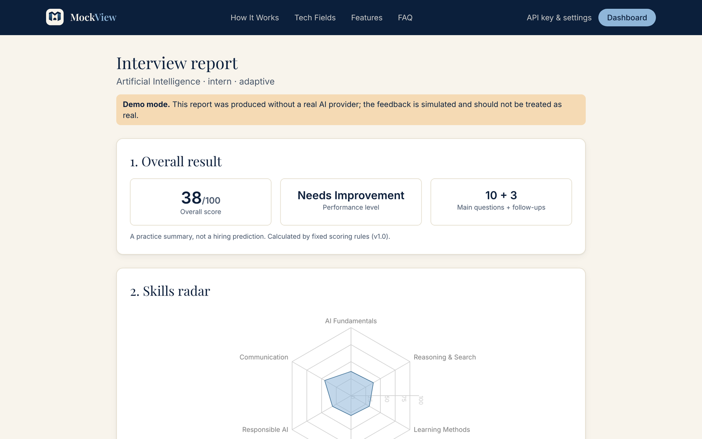
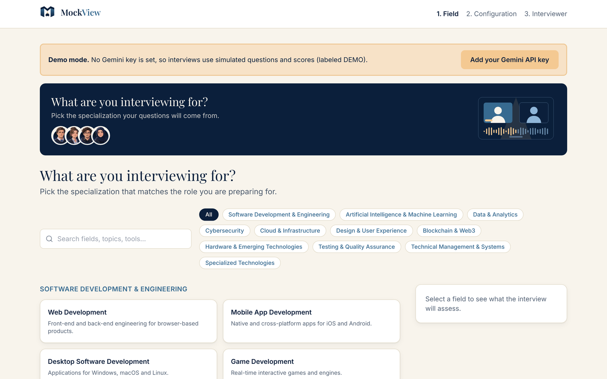
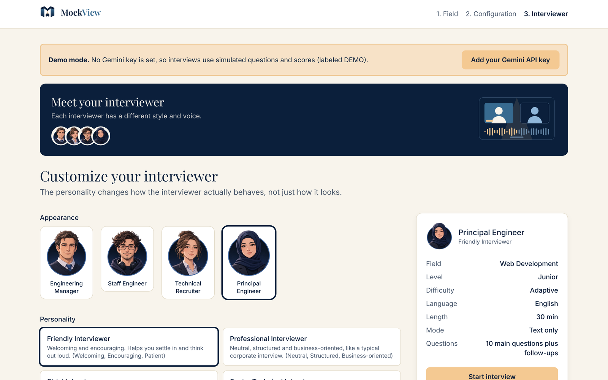
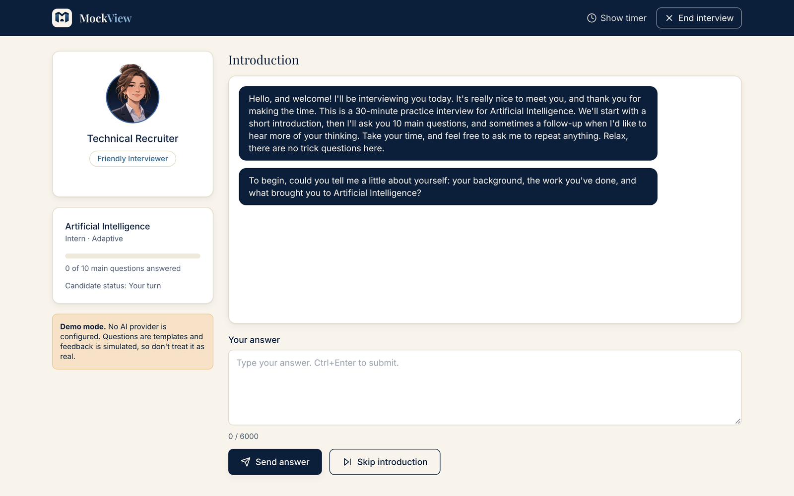
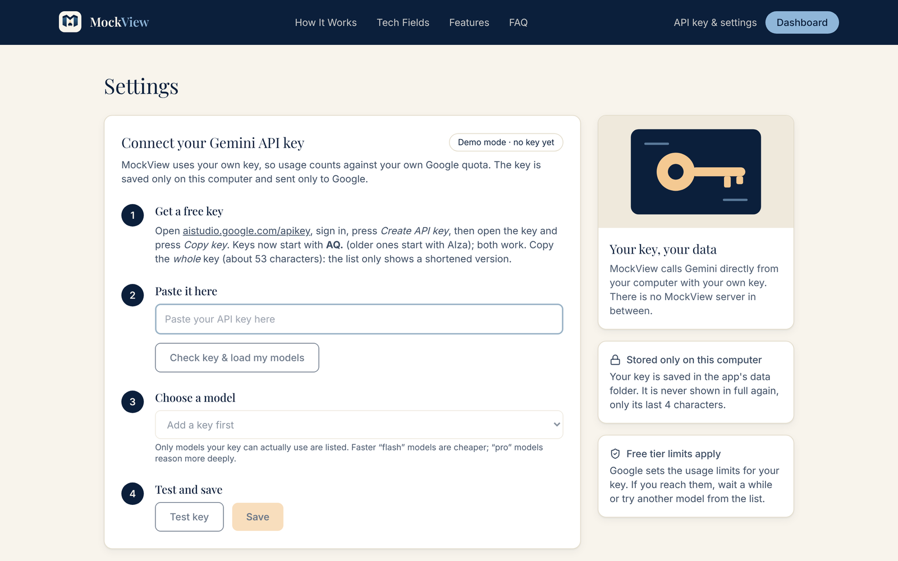

<div align="center">



<br>


<a href="../../releases/latest/download/MockView_installer.exe"></a>
<a href="../../releases/latest"></a>

</div>

<br>

**MockView** is a desktop app for practicing technical interviews out loud. Pick one of 64 specializations, choose an interviewer, and hold a spoken interview made of a short introduction and exactly 10 main questions, with adaptive follow-ups when an answer is thin. When you finish, you get a scored report that shows what to fix first.

It runs on **your own computer** with **your own free Gemini API key**. There is no MockView server, no account and no hosting bill, and your interviews stay on your machine.

<div align="center">

</div>

<div align="center">

</div>

## How an interview works



## What you get in the report

Every finished interview produces a report you can keep, export as a PDF and compare with earlier ones:

| Section | What it shows |
|---|---|
| Overall result | A score out of 100, a performance level and how many questions and follow-ups were asked |
| Skills radar | Your score on each skill area of the chosen field |
| Strengths and gaps | What you did well and where answers were weak |
| Recommendations and roadmap | A short practice plan, ordered by what to fix first |
| Progress and compare | Score over time, and side-by-side comparison of two interviews |

Scores come from **fixed scoring rules** (version 1.0), not from the model's mood: the same answers always produce the same score. The AI only supplies a judgment for each criterion. The report is a practice summary, not a hiring prediction.

<div align="center">

</div>

## Screenshots

<table>
  <tr>
    <td><br><sub>Choose from 64 specializations in 11 categories</sub></td>
    <td><br><sub>Pick an interviewer and a personality</sub></td>
  </tr>
  <tr>
    <td><br><sub>The interview room</sub></td>
    <td><br><sub>Connect your key and pick a model from your own list</sub></td>
  </tr>
</table>

## Specializations

64 fields across 11 categories: Software Development and Engineering, Artificial Intelligence and Machine Learning, Data and Analytics, Cybersecurity, Cloud and Infrastructure, Design and User Experience, Blockchain and Web3, Hardware and Emerging Technologies, Testing and Quality Assurance, Technical Management and Systems, and Specialized Technologies.

## The interviewers

Four interviewer roles, shown by their role only: **Engineering Manager**, **Staff Engineer**, **Technical Recruiter** and **Principal Engineer**. Each can be set to a personality (friendly, professional, strict or senior technical), which changes how questions are asked and how many follow-ups you get, not just how the interviewer looks. The interviewer speaks with a voice installed on your computer, and you can choose a male or female voice in English or Arabic.

## Features

| Area | Details |
|---|---|
| Spoken interview | The interviewer talks; you answer by voice or by typing. Voice answers are recorded in the app and transcribed with your Gemini key |
| Adaptive | Level, difficulty and personality shape the questions; follow-ups target weak answers |
| Tailored | Optional resume (PDF) and job description make the questions specific to you |
| Reports | Score, skills radar, strengths, gaps, roadmap, PDF export |
| Progress | Interview history, score over time and side-by-side comparison |
| Bilingual | English and Arabic interviews |
| Honest demo mode | With no key the app runs a clearly labeled demo with scripted questions. Demo scores are excluded from your progress |
| Private | Your key and data stay on your computer. Audio is never stored |

## Download and install

| Option | How |
|---|---|
| **Windows** | Download [`MockView_installer.exe`](../../releases/latest/download/MockView_installer.exe), double-click it, choose the install folder and wait for the progress bar. A **MockView** icon appears on your desktop and in the Start menu |
| **macOS** | No installer yet. Run from source (see *For developers*) |
| **Linux** | Download `MockView.AppImage` from [Releases](../../releases/latest), make it executable and double-click it |

The installers are **not code-signed**, so Windows may show *Windows protected your PC*. Choose **More info**, then **Run anyway**. MockView has its own window and taskbar icon and does not open in a browser.

### First launch

1. Open **API key & settings** and get a free key from [Google AI Studio](https://aistudio.google.com/apikey).
2. Paste the key and press **Check key & load my models**. MockView lists the models your key can use.
3. Pick a model, press **Test key**, then **Save**.
4. Press **Start New Interview**.

Without a key you can still try the **demo mode**: it uses simulated questions and scores, and says so on screen. Google sets the usage limits for your key, so MockView does not promise unlimited use.

Your data and key are stored in `%APPDATA%\MockView` (Windows), `~/Library/Application Support/MockView` (macOS) or `~/.config/MockView` (Linux). The key is never shown in full again, only its last 4 characters. To start fresh, close the app and delete that folder.

## Privacy

- Your Gemini key is stored only on your computer and is sent only to Google.
- Interview answers go to Google's Gemini API to generate questions and judgments, under your own key and Google's terms.
- For voice answers, a short recording is sent to Google for transcription with your key. MockView does not save the audio.
- Resumes are used only with your consent, and you can delete an interview, a resume or all your data at any time.

## Technical notes

- **Desktop shell:** Electron, which starts the local API and the web interface and shows them in a native window.
- **Interface:** Next.js (App Router), TypeScript, Tailwind CSS and Recharts.
- **Local API:** FastAPI, SQLAlchemy and Alembic, packaged with PyInstaller. SQLite is used on your computer.
- **Scoring:** deterministic engine in `backend/app/scoring/engine.py` (version 1.0). The model supplies per-criterion judgments only.
- **AI:** Google Gemini through your own API key. Models are listed from your key, and keys starting with `AQ.` or `AIza` both work.
- **Brand:** Navy `#0B1F3B`, Slate `#376A90`, Soft Blue `#8FB6D9`, Sand `#F4C992`, Cream `#F8F4EC`. Playfair Display and Inter.

## Honest status

Verified by the author: backend tests (SQLite and PostgreSQL), frontend tests, type-check, production build, and a Playwright end-to-end and axe accessibility suite. **Not verified by the author:** real Gemini calls, real microphones and voices, the Linux build, expert review of the question content for all 64 specializations, and legal review of the privacy and terms pages. The logo is an SVG recreation of the brand artwork.

## For developers

### Run from source on your own computer
You need **Python 3.10+**, **Node.js 20+** and **Chrome or Edge**.

- **Mac / Linux:** run `./start.sh` in this folder.
- **Windows:** double-click `start.bat`.

The first run installs and builds everything, then opens http://localhost:3000. Local mode (`LOCAL_MODE=1`, set by the scripts) has no accounts and no usage limits, and only answers requests addressed to localhost.

### Build the desktop installer
Push a tag such as `v1.0.0`, or run **Actions → release → Run workflow**. `.github/workflows/release.yml` builds the Windows and Linux installers with electron-builder on GitHub's free runners. To build locally:

```bash
cd frontend && NEXT_PUBLIC_API_URL=http://localhost:8000 npm run build
cd .. && python desktop/package_web.py desktop/dist
pyinstaller desktop/mockview.spec --distpath desktop/dist
cd electron && npm install && npx electron-builder
```
Icons come from `desktop/assets/make_icons.py` (copy its outputs into `electron/build/`).

### Hosted mode (Supabase login)
```bash
cd backend && python -m venv .venv && . .venv/bin/activate && pip install -r requirements.txt
cp .env.example .env && alembic upgrade head && uvicorn app.main:app --reload     # :8000
cd ../frontend && cp .env.example .env.local && npm ci && npm run dev               # :3000
```
Sign-in needs Supabase (below). `./e2e/run.sh` runs the whole app with a mock login if you just want to click through.

### Configure (hosted mode)
1. **Supabase:** create a project; put URL + anon key in `frontend/.env.local`, and the **JWT secret** in `backend/.env` (`SUPABASE_JWT_SECRET`). Optional `SUPABASE_URL` + `SUPABASE_SERVICE_ROLE_KEY` (server only) lets "Delete my account" remove the login too.
2. **AI provider** (`backend/.env`): `LLM_PROVIDER=openai_compatible | anthropic | gemini | demo`, plus `LLM_MODEL`, `LLM_API_KEY` (and `LLM_BASE_URL` for OpenAI-compatible). Gemini keys from Google AI Studio start with `AQ.` (newer) or `AIza` (older); both work. `AQ.` keys are tried on the Gemini API first and on Vertex AI second.
   Check it from your own machine: `cd backend && python -m app.tools.check_llm` (never prints the key).
3. **Database:** `alembic upgrade head` (the Docker image does this on start). Use Postgres in production.
4. **Admin:** in Supabase → Authentication → Users → edit the user's **app_metadata** to `{"role":"admin"}` (not user_metadata, which users can edit). Admins see metadata only, never answers or resumes.
5. **Cost limits:** `DAILY_INTERVIEW_LIMIT` per user (default 3), `GLOBAL_DAILY_INTERVIEW_LIMIT` site-wide (default 300, 0 = off).


### Docker
```bash
docker compose up --build     # db + backend :8000 + frontend :3000
```
`NEXT_PUBLIC_*` values are baked in at build time (compose passes them as build args).


## Tests
```bash
cd backend && pytest -q                                   # SQLite
TEST_DATABASE_URL=postgresql+psycopg://u:p@host/db pytest -q   # PostgreSQL
cd frontend && npx tsc --noEmit && npm test && npm run build
./e2e/run.sh                                              # needs Chromium: npx playwright install chromium
```


### Operations notes
- Run the backend with **one worker**: the write rate limiter is in-memory. Scale out only after moving it to Redis.
- Behind a proxy you control, set `TRUST_PROXY=1`. Set `APP_ENV=production` (hides API docs). Optional `SENTRY_DSN`.
- Scoring is deterministic (`app/scoring/engine.py`, version 1.0); the LLM only supplies per-criterion judgments.
- See `docs/DEPLOYMENT.md`.

## Credits

Created by **Ahmed Elmasry** ([@Ahmed-ssam](https://github.com/Ahmed-ssam)). Fonts: Playfair Display and Inter, under the SIL Open Font License.
